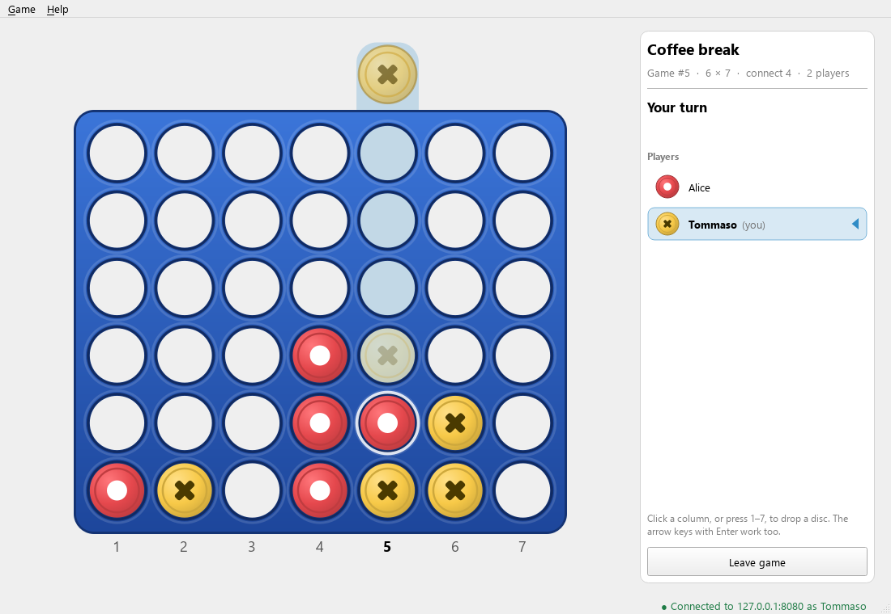

# ConnectX Game Suite

Connect X game with client-server architecture enabling local/online multiplayer and AI opponents.
Modular design with decoupled game engine, network protocol, CLI/GUI interfaces and a from-scratch AI module (from alpha-beta to neural networks trained by self-play, up to an Arduino).


## Story

The project was born during Christmas holidays back in 2017, as a simple implementation of the classic Connect 4 game.
This was actually my tentative to practice a bit of `C` programming language, which I had just started to learn at high school with some basic concepts.
At the time of the [first implementation](https://github.com/Bocchio01/connectx-game-suite/blob/b49d9c361ce1d9fe050c7089223ad08af99b6da1/Main.c), I had no idea about arrays and the program turned out to be an ugly mess of 1400 lines.
Luckily, soon after that, I learned about arrays and the code was refactored to be much more readable and maintainable.

Leaving the project aside for a while, in 2023 I had the need to practice about managing larger `C/C++` projects and decided to improve once again this repo by cleaning up the code, modularizing it and playing around with proper build systems.

Despite being already functional, I always had the dream of adding networking capabilities to the game, removing the need of having both players on the same machine.
So here we are in 2025, with a complete rework of the project, now called **ConnectX Game Suite**, which includes a proper client-server architecture, enabling local/online multiplayer and AI opponents (the [AI module](ai/README.md) and the [graphical client](ui/gui/README.md) are the latest additions).


## Overview

ConnectX Game Suite is a (semi-)professional implementation of the classic Connect 4 game built with modern `C++` and with a focus on clean architecture.
The project demonstrates how to build a networked multiplayer game with properly separated concerns, making each component testable and reusable independently.
The implementation uses a client-server model where a central server manages game sessions while multiple clients can connect to play.


The modular design allows for multiple deployment scenarios.
Players can compete locally on the same machine, play online across different networks, or challenge AI opponents.
The system supports custom board sizes, variable player counts, and different win conditions.
Games can be created with names for easy discovery, and automatic matchmaking connects players to available sessions.

Each module serves a specific purpose.
- **Core**: handles all game logic, including board state, move validation, and win detection;
- **Protocol**: defines the message formats and communication rules between clients and server;
- **Server**: manages multiple game sessions, enforces rules, and coordinates player interactions;
- **Client library**: provides a high-level API for clients to interact with the server, abstracting away networking details;
- **CLI**: offers a terminal-based interface for players to join games and make moves.
- **GUI**: a graphical client built with Qt 6 on top of the client library: connect, browse and create games, play ([ui/gui](ui/gui/README.md)).
- **Web gateway**: lets web browsers play on the server, which they cannot reach on their own (a page cannot open a TCP connection): it carries their WebSocket connections to it, and the server stays as it is ([network/gateway](network/gateway/README.md)).
- **AI module**: computer-controlled opponents, all written from scratch for learning purposes: random and rule-based players, minimax, alpha-beta, an exact solver, Monte Carlo tree search and neural networks (from a plain policy/value network to AlphaZero-style self-play), plus the tools to compare and train them and the road to TensorFlow Lite and an Arduino ([ai](ai/README.md)). An AI player is just another client of the server: it is indistinguishable from a human one.


## Quick start guide

Here's a quick guide to get you started with `ConnectX Game Suite`.

### Building from source

The project uses `CMake` (3.16 or newer) and a C++17 compiler; the libraries it needs (`spdlog`, `sockpp`, `nlohmann/json`) are downloaded by CMake itself.
To build the project, simply run the following commands in the project root directory:

```bash
git clone https://github.com/Bocchio01/connectx-game-suite.git
cd connectx-game-suite
mkdir build && cd build
cmake ..
cmake --build .
```

This will generate the executables (server, CLI and GUI clients, AI tools) in the `build/bin` directory.
What gets built is controlled by a few options (`cmake -DNAME=VALUE ..`):

| Option | Default | What it does |
|---|:-:|---|
| `BUILD_GUI` | `ON` | the graphical client; it needs [Qt 6](https://www.qt.io/download-qt-installer) (Widgets). If CMake cannot find Qt it prints a warning and skips the GUI: point `CMAKE_PREFIX_PATH` to a Qt kit (e.g. `-DCMAKE_PREFIX_PATH=C:/Qt/6.9.3/mingw_64`) or switch it off with `-DBUILD_GUI=OFF` |
| `BUILD_AI` | `ON` | the AI module: `connectx-ai` (computer player), `connectx-arena` (tournaments), `connectx-train` (training) and the pretrained network |
| `BUILD_GATEWAY` | `ON` | the web gateway, `connectx-gateway`: the WebSocket front door that lets web browsers play (it needs `BUILD_NETWORK`, and offers computer opponents if `BUILD_AI` is on too) |
| `BUILD_TESTS` | `OFF` | the unit and integration tests, then run `ctest` in the build directory |
| `BUILD_CLI`, `BUILD_NETWORK`, `BUILD_CORE` | `ON` | the command-line client, the network components (server, client library), the game engine |

### Running the first game

To start a server, run the following command in a terminal:

```bash
./connectx-server
```

This will start the server on the default port `8080`.
In another terminal, start a client to connect to the server:

```bash
./connectx-cli
```

This will launch the CLI interface, that will automatically connect to the server running on `localhost:8080` and join an open game or create a new standard game if none is available.
Wait for another player to join the game (you can open another terminal and start another client to simulate a second player) and just have fun!

If you prefer windows to a terminal, `./connectx-gui` does the same with a graphical interface ([details](ui/gui/README.md)):



### Playing against the computer

A computer player is a client like any other: start it in another terminal and tell it which game to join.

```bash
./connectx-cli -g "Duel<6 7 2 4>"                                 # you create the game "Duel" (6 rows, 7 columns, 2 players, connect 4)
./connectx-ai  -g Duel --agent alphabeta:depth=10,time=1000       # the computer joins it
```

The graphical client does all of this for you: choose *the computer* (and one of five strength levels) when creating a game in the lobby, or press *Play offline against the computer* on the first page (`./connectx-gui --offline`), which even starts a private server on your machine, so no terminal is needed at all ([details](ui/gui/README.md#playing-against-the-computer)).

`--agent` selects the algorithm, from `random` and `greedy` through `minimax`, `alphabeta`, `mcts` and the exact `solver` to the neural networks (`nn`, `nnsearch`, `az`); `connectx-ai --list-agents` describes them all.
The [AI guide](ai/README.md) explains how each of them works, how strong it is (a tournament table) and how to train your own network, and the [Arduino guide](ai/arduino/README.md) how to play against a network running on a microcontroller.

### Hosting the server

Running on a local machine is fine for testing, but if you want to play online with friends, you'll need to host the server on a public machine.
You can use any VPS provider or cloud service that allows you to run custom applications.
Make sure to open the server port in the firewall settings to allow incoming connections.
Once the port is open, start the server on the public machine in daemon mode:

```bash
./connectx-server --daemon --port X
```

Then, when starting the client, specify the server address:

```bash
./connectx-cli --host X.X.X.X --port X
```

Replace `X.X.X.X` with the public IP address of the server and `X` with the port number you configured.

By default the server listens on every network interface. To accept only clients running on the same machine (a private server for a single player, which is also how the GUI plays offline against the computer) add `--bind 127.0.0.1`.

> [!TIP]
> @DLR, you can find an instance of the server running on the node `rmc-lx0274:8080`.
> Connect to it using `./connectx-cli --host rmc-lx0274`, or directly modify the constructor of the `CLIInterface` class by replacing the current default `localhost`.

#### Playing from a web page

A browser cannot open a TCP connection, so a web page cannot connect to the server by itself. The [web gateway](network/gateway/README.md) is the adapter: `./connectx-gateway` accepts WebSocket connections and carries each one to the server over a TCP connection of its own, so that a page can do everything the other clients do (lobby, rooms, quick match, the computer).
The server is not modified and can keep listening on the machine itself: only the gateway, behind a reverse proxy such as `nginx` that provides TLS, faces the internet. The gateway's README explains the protocol for those who write a web client, and how to run both programs as services behind `nginx`.


## Known issues

The game is overall stable, but there are still some known issues/bugs:
- **User input handling in CLI**: if the user inputs valid data while waiting for its turn, the input is stored in the input buffer and processed when the turn actually arrives, which leads to unvoluntary moves. A possible solution is to flush the input buffer when the turn starts or going dual-threaded and have a dedicated thread for user input (overkill);
- **Server disconnection handling**: again, if a client is waiting for user input and the server shut downs, the client will not be able to process the disconnection event until the user inputs something. I guess here the only solution is to go dual-threaded..;
- **AI limits**: the computer players handle two-player games on boards that fit a 64-bit bitboard (`columns × (rows + 1) ≤ 64`, e.g. 6×7, 7×7, 7×8 or 5×9) and refuse other games with an explanation; the pretrained network is for the standard 6×7 board with connect 4 (the search algorithms work on any supported board);

The first two affect the CLI only: the graphical client is driven by events and has neither problem.


## Future improvements

Scalability is a concern, as the server makes intense use of synchronous/blocking calls via `mutexes` to ensure thread safety.
This is fine for probably handling some dozens of games and few hundreds of concurrent players, but for larger scale deployments, an asynchronous/event-driven architecture would be more appropriate.
Load testing and profiling will be performed in the future to identify bottlenecks and optimize performance.

The [AI module](ai/README.md) implements the classic algorithms (minimax, alpha-beta pruning, an exact solver, Monte Carlo tree search) and neural networks up to AlphaZero-style self-play, all written from scratch, together with the workflow to export a network to `TensorFlow` and `TensorFlow Lite` and run it on an Arduino.
Natural next steps: convolutional networks (they need a GPU to train in reasonable time, which is what the TensorFlow route is for), an opening book for the solver, games with more than two players, and trying the sketch on real hardware.


## Contributing

Contributions are welcome! If you find a bug or have a feature request, please open an issue on GitHub.
If you want to contribute code, please fork the repository and create a pull request with your changes.

Have a nice coding day,

Tommaso :panda_face:
