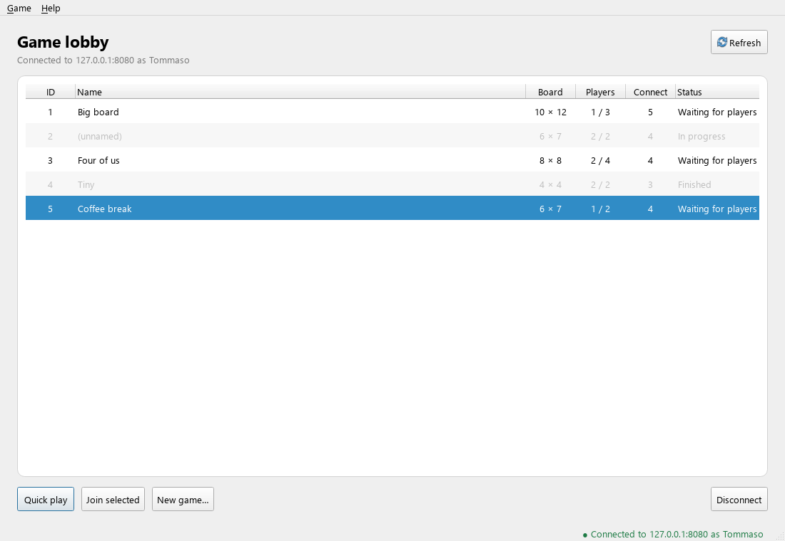
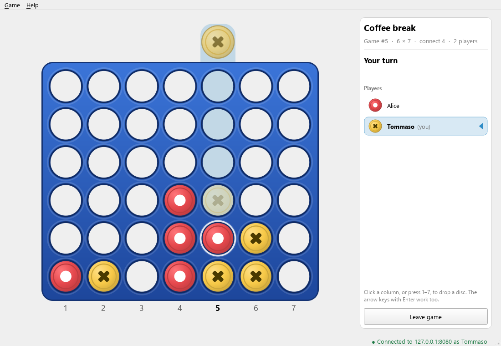
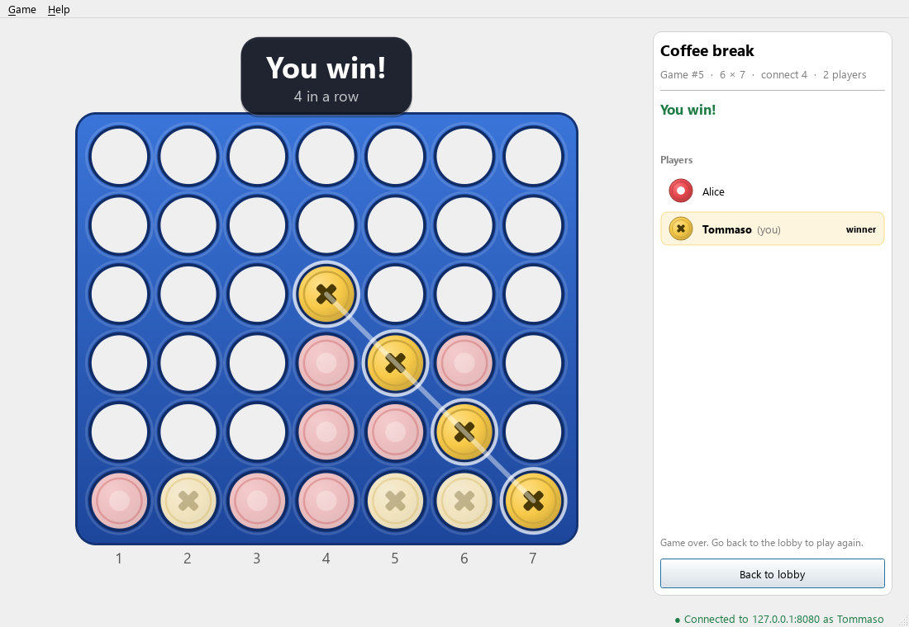
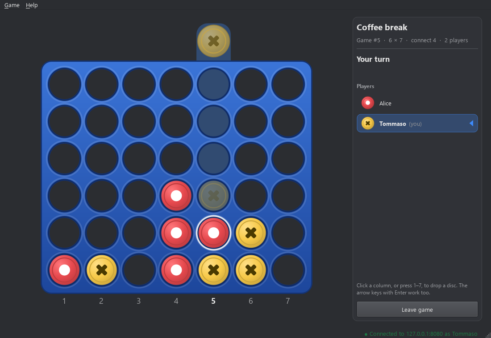
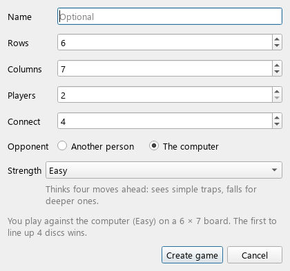
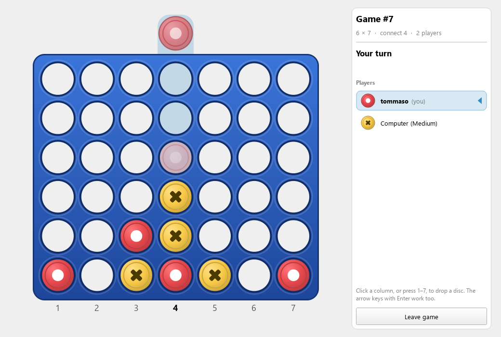
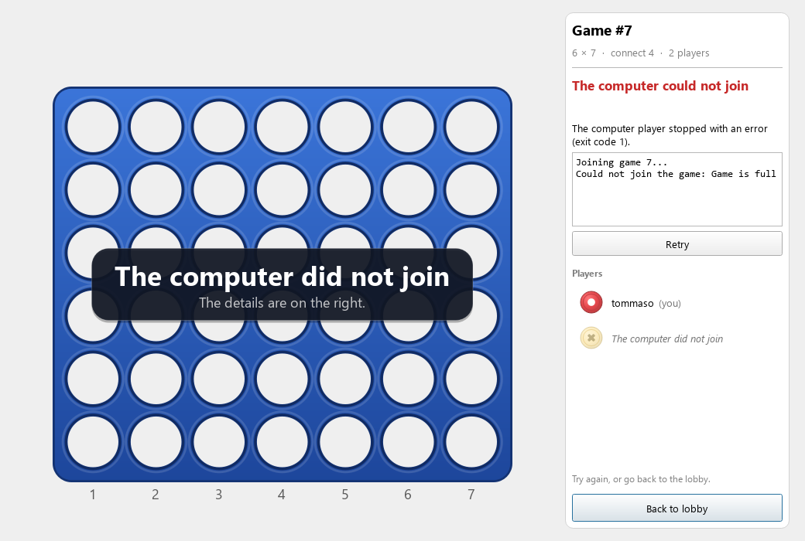
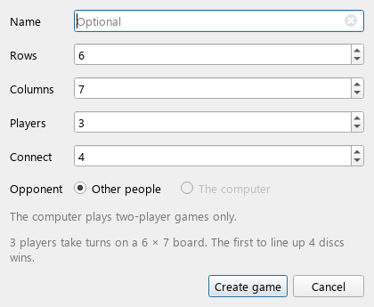
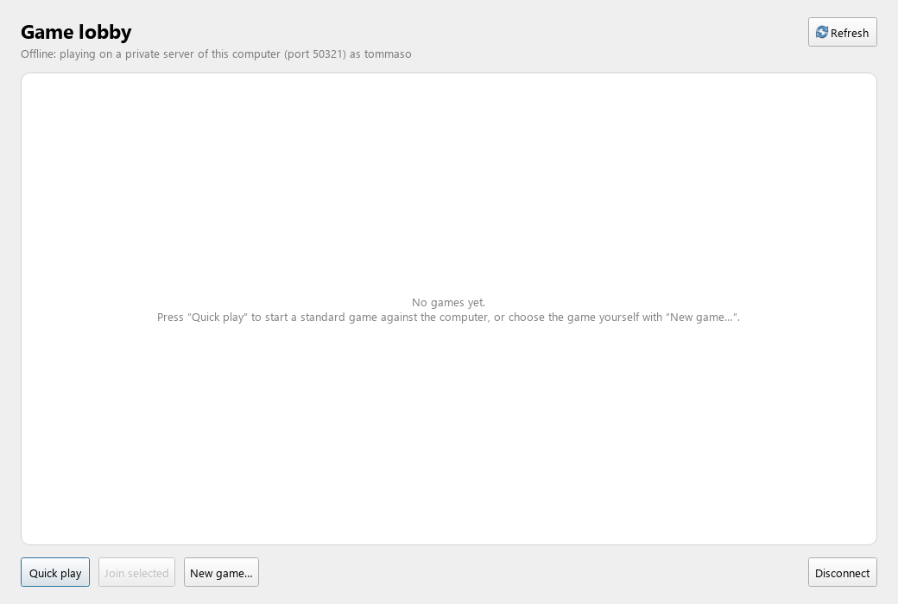

# ConnectX GUI (`connectx-gui`)

The graphical client of the ConnectX Game Suite: a Qt 6 Widgets application that plays Connect X
(board from 4x4 to 20x20, 2 to 4 players, any connect length) against other people over the network, or
**against the computer**, with or without a server of your own.
It is built **on top of the network client library** (`Connectx::client`), exactly like the CLI in
[`ui/cli`](../cli): connect to a `connectx-server`, list/create/join games, play. The computer opponent is not
part of the GUI: it is `connectx-ai`, a client like any other that the GUI starts as a separate program
(see [*Playing against the computer*](#playing-against-the-computer)).

| Lobby | Game in progress |
| :---: | :---: |
|  |  |
| **Victory** | **Dark theme** |
|  |  |

More pictures: [connect page](../../docs/gui-connect.png), [waiting for the other players](../../docs/gui-waiting.png),
[a draw](../../docs/gui-draw.png), [lobby, dark theme](../../docs/gui-lobby-dark.png), and the pictures of
[playing against the computer](#playing-against-the-computer).

## Features

* **Three pages in one window**: Connect -> Lobby -> Game, a menu bar (Game: Disconnect, Quit; Help: About)
  and a status bar that always shows the state of the connection (`host:port`, player name).
* **Connect page**: server address, port (default 8080) and player name (default: the name of the operating
  system user, at most 32 characters). The last values are remembered. Connecting never blocks the window:
  there is a busy state with a *Cancel* button, and failures (refused, unknown host, no answer...) are
  explained under the form.
* **Lobby**: the list of games (ID, name, board, players n/m, connect length, status) refreshes by itself every
  2 seconds without losing the selection. *Quick play*, *Join selected* (only games that wait for players and are
  not full; double click or Enter also join), *New game...* (name, rows, columns, players, connect length, all
  validated; creating a game also joins it) and *Disconnect*. Errors from the server are shown inline and in the
  status bar, never in a stream of modal dialogs.
* **Game page**: a custom painted board that scales with the window and works for every size, discs that
  really fall (only the *new* disc is animated, never the whole board), a ghost disc and a highlighted
  column under the mouse when it is your turn, a marker on the last move, a highlighted winning line, banners
  for waiting/result, and a side panel with the players, whose turn it is, the game info and a status line
  ("Your turn", "Waiting for Alice...", "You win!", "Bob wins", "It's a draw"...).
* **Colour-blind friendly**: every player has a colour *and* a symbol (red dot, yellow cross, cyan diamond,
  violet triangle).
* **Mouse and keyboard**: click a column, or press `1`-`9`; `Left`/`Right` (and `Home`/`End`) move a cursor
  over the columns and `Enter`/`Space` drop the disc (use these on boards wider than 9 columns).
* **Leaving**: *Leave game* asks for confirmation while a game is in progress; once the game is over the
  button becomes *Back to lobby*. The protocol has no "leave game" message and one connection carries one game,
  so both simply open a fresh connection with the same parameters, transparently.
* **Robust**: server closing the connection, network errors, the other players leaving, closing the window at any
  moment (connecting, lobby, waiting, mid-game, after the end) all end cleanly, without hanging.
* **Looks right in light and dark mode**: the chrome follows the system palette (only the discs and the board
  have fixed colours), and the board is HiDPI aware.
* **The computer as opponent**: *New game...* asks who to play against, other people or the computer at one
  of five levels (Beginner to Expert). The game page says "Waiting for the computer..." until it has joined,
  explains what went wrong (with *Retry*) when it cannot, and offers *Play again* at the end.
* **Offline**: *Play offline against the computer* on the Connect page starts a private server on this
  computer by itself and opens the New game dialog: no network, nothing to start by hand.

## Building

### Requirements

* Qt **6.2 or newer**, modules *Widgets* and *Network* (the second one only to find a free port and to probe the
  private server of offline games); developed and tested with Qt 6.9.3. For the tests also *Test* (all are part of
  a normal Qt installation).
* CMake 3.16+, a C++17 compiler. On Windows with the MinGW kit of Qt use **Qt's own MinGW**
  (`C:/Qt/Tools/mingw1310_64`), not another MinGW: the C++ ABIs differ.
* Optional, for the computer opponent and offline games: the `connectx-ai` and `connectx-server` programs
  (the root project builds both next to `connectx-gui`; see *Playing against the computer*).

### With CMake (command line)

The GUI is a normal sub-directory of the root project (there is no `project()` in `ui/gui/CMakeLists.txt`),
enabled by the `BUILD_GUI` option of the root `CMakeLists.txt`. Tell CMake where Qt 6 is with
`CMAKE_PREFIX_PATH`:

```bash
# Linux / macOS
cmake -S . -B build -DCMAKE_PREFIX_PATH=~/Qt/6.9.3/gcc_64
cmake --build build
./build/bin/connectx-gui
```

```powershell
# Windows, MinGW kit of Qt (Qt Creator does the same for you)
$env:PATH = "C:\Qt\Tools\mingw1310_64\bin;C:\Qt\Tools\Ninja;C:\Qt\Tools\CMake_64\bin;" + $env:PATH
cmake -S . -B build -G Ninja `
      -DCMAKE_CXX_COMPILER=C:/Qt/Tools/mingw1310_64/bin/g++.exe `
      -DCMAKE_C_COMPILER=C:/Qt/Tools/mingw1310_64/bin/gcc.exe `
      -DCMAKE_PREFIX_PATH=C:/Qt/6.9.3/mingw_64 -DCMAKE_BUILD_TYPE=Release
cmake --build build
```

The executables (`connectx-gui`, `connectx-server`, `connectx-cli`...) end up in `build/bin`. Distribution packages
of Qt (for example `qt6-base-dev` on Debian/Ubuntu) are found without any `CMAKE_PREFIX_PATH`.

| Option | Default | Meaning |
| --- | --- | --- |
| `BUILD_GUI` | `ON` (root option) | Build the GUI at all (`-DBUILD_GUI=OFF` to skip it). |
| `CONNECTX_GUI_REQUIRED` | `OFF` | Fail the configuration when Qt 6 is missing, instead of skipping the GUI (see below). |
| `CONNECTX_GUI_DEPLOY_QT` | `OFF` | Windows only: run `windeployqt` after building, to copy the Qt DLLs and plugins next to `connectx-gui.exe`. |
| `BUILD_TESTS` | `OFF` | Also build and register the GUI tests (see *Tests*). |

### What happens when Qt is missing

Most machines and CI runners have no Qt, and the GUI is built by default, so a missing Qt 6 **does not fail
the configuration**: `ui/gui/CMakeLists.txt` prints a loud (but non-fatal) warning and skips the GUI. The server,
the CLI, the AI and their tests configure and build normally; nothing else depends on the GUI targets.

```
CMake Warning at ui/gui/CMakeLists.txt:22 (message):
  Qt 6 (>= 6.2, Widgets and Network modules) was not found.
  Point CMAKE_PREFIX_PATH to a Qt 6 kit, e.g. -DCMAKE_PREFIX_PATH=C:/Qt/6.9.3/mingw_64 (or ~/Qt/6.9.3/gcc_64).
  The GUI client is NOT built.  Silence this with -DBUILD_GUI=OFF, or make it an error with -DCONNECTX_GUI_REQUIRED=ON.
```

Use `-DBUILD_GUI=OFF` to silence the warning, or `-DCONNECTX_GUI_REQUIRED=ON` (handy in CI) to turn it into an error.
(The summary at the end of the root configuration still prints `GUI client: ON`: that is the *option*, not the outcome.)

### With Qt Creator

Open the **root** `CMakeLists.txt` of the repository (not the one in `ui/gui`, which is only a sub-directory and
cannot be configured alone), pick a Qt 6 kit, and build the `connectx_gui` target. The old `ui/gui/build`
directory and `CMakeLists.txt.user` left by the original "empty window" template are not used any more.

### Running on Windows: Qt libraries

`connectx-gui.exe` needs the Qt DLLs. Either run it from a shell where `C:\Qt\6.9.3\mingw_64\bin` (and
`C:\Qt\Tools\mingw1310_64\bin`) are on `PATH`, or configure with `-DCONNECTX_GUI_DEPLOY_QT=ON` once, which runs
`windeployqt` after each build.

## Running

Start a server first, then the GUI (they can be on different machines):

```bash
./connectx-server                # listens on port 8080 (see --help for --port, --daemon)
./connectx-gui                   # the Connect page opens
./connectx-gui --host 192.168.1.20 --name Alice --connect    # connect straight away
./connectx-gui --offline --name Alice                        # no server needed: play against the computer
```

### Command-line options

| Option | Meaning |
| --- | --- |
| `--host <host>` | Server address to prefill (default: the last one used, or `localhost`). |
| `-p, --port <port>` | Server port to prefill (default: the last one used, or 8080). |
| `-n, --name <name>` | Player name to prefill (default: the last one used, or the operating system user). |
| `--connect` | Connect right away, without waiting for the *Connect* button. |
| `--offline` | Start an offline game against the computer right away, as if *Play offline against the computer* had been pressed. |
| `--settings-dir <dir>` | Keep the settings in an `.ini` file inside `<dir>` instead of the system store. |
| `--quit-after <ms>` | Developer option: quit after that many milliseconds (smoke tests). |
| `-h, --help`, `-v, --version` | Usual. |

Qt's own options (`-style fusion`, `-platform offscreen`...) and environment variables (`QT_SCALE_FACTOR=2`) work too.
The Client library logs through spdlog; the GUI keeps it at the `error` level like the CLI. Set `SPDLOG_LEVEL=debug`
to see everything.

### Settings

Stored with `QSettings` (organisation `Bocchio01`, application `ConnectX`) in the system store: the registry
under `HKEY_CURRENT_USER\Software\Bocchio01\ConnectX` on Windows, `~/.config/Bocchio01/ConnectX.conf` on Linux,
the preferences on macOS. Keys: `connection/host`, `connection/port`, `connection/name` (saved when you press
*Connect*), `window/geometry` (saved when the window closes), `newGame/rows|cols|players|connect` (the numbers of
the *New game* dialog, saved when you create a game), `newGame/opponent|level` (person or computer, and its level).

## Using the program

1. **Connect**: check the server, port and name, press *Connect* (or `Enter`). While it connects you can press *Cancel*.
2. **Lobby**: *Quick play* joins the first open unnamed game, or lets the server start a standard 6x7 game for two.
   *New game...* lets you choose everything, including whether to play against other people or the computer; a name
   makes the game easy to find, and named games can only be joined from the list. Games that wait for players are
   shown in normal text, the others (started, full, finished) are greyed out. The game starts by itself when the last
   seat is taken, and the server picks who starts at random.
3. **Game**: when it is your turn the column under the mouse is highlighted and a ghost disc shows where the disc
   would land. Click, or use the keys. The side panel shows who is to move (the arrow), who left the game
   ("(left)") and the result. When everybody else has left a game in progress the game cannot continue and you
   are offered *Back to lobby*.
4. **Back to lobby / Leave game / Game > Disconnect**: see *Features*. If the server disappears in the middle of
   a game the board stays on screen with "Connection lost" and *Back to lobby* tries to reconnect (if it cannot,
   the Connect page shows why).

## Playing against the computer

| New game: the computer | A game against the computer |
| :---: | :---: |
|  |  |

### How it works

The computer opponent is **`connectx-ai`**, the computer player of the suite: a separate program that connects to
the server like any other client, joins a game that already exists, and plays it. The GUI does **not** link the AI
library; it runs the program as a child process, exactly as you would from a terminal:

```
connectx-ai --host <host> --port <port> -g <game id> --agent <spec> -n "Computer (Easy)" --games 1 --delay 500
```

1. In *New game...* choose **Opponent: The computer** and a strength. *Create game* does what it always does
   (creates the game, with the name you typed if any, and puts you in it).
2. The GUI then starts `connectx-ai` for that game, with the host and the port of your connection. The game page
   says "Waiting for the computer..." until it has joined; then the game starts (the server picks who moves first).
3. The computer never answers faster than half a second (`--delay 500`), so that you can follow what happens. It is
   called "Computer (Easy)", "Computer (Hard)"... in the player list.
4. When the game is over the program ends by itself (exit code 0) and the page offers **Play again**: a new game
   with the same settings against a new computer player (on a new connection, like *Back to lobby*), or **Back to
   lobby**.

If the program cannot be started, or stops with an error before the game has begun (for instance "Could not join the
game: Game is full" because someone took the seat), the game page shows what happened with the last lines the program
printed, and offers **Retry** or **Back to lobby**:



### The levels

The table lives in one small file, `src/computer_levels.cpp`, so that it can be tuned. The agent specs are the ones of
`connectx-ai --list-agents`; the network is the pretrained model `models/connectx_6x7.cxnn` of the AI module,
which only exists for the standard board. The Elo ratings are from the tournament of the AI module on the standard
board (1000 = the average of the field); the user interface shows no numbers, only a line and a tooltip per level.

| Level | What the dialog says | Standard board (6 x 7, connect 4), network found | Any other supported board |
| --- | --- | --- | --- |
| 1 Beginner | Sees only the next move: takes a win, blocks yours, otherwise stays near the centre. | `greedy` (Elo 713) | `greedy` |
| 2 Easy | Thinks four moves ahead: sees simple traps, falls for deeper ones. | `alphabeta:depth=4` (949) | `alphabeta:depth=4` |
| 3 Medium | Thinks eight moves ahead: rarely misses a tactic. | `alphabeta:depth=8` (1079) | `alphabeta:depth=8` |
| 4 Hard | A strong player: it hardly ever overlooks a threat. | `az:model=connectx_6x7,sims=100` (1175) | `mcts:sims=3000,rollout=tactical` |
| 5 Expert | The strongest level: slow to answer, very accurate. | `az:model=connectx_6x7,sims=400` (1342) | `mcts:sims=10000,rollout=tactical` (1247) |

When the network file is not found (next to `connectx-ai`, see below) the strongest levels play with the search of
the last column on every board. The first default level is *Easy*; the dialog remembers the last choice.

### Which games the computer can play

*The computer* is disabled in the dialog, with a tooltip (and a line under the buttons) that says why, when:

* the game has **more than two players** (the computer plays two-player games only);
* the board **does not fit its engine**: columns x (rows + 1) must not exceed 64 (6 x 7, 7 x 8, 5 x 9, 4 x 12 are
  fine, 8 x 8 is not), the connect length must be at least 3 and fit on the board;
* the **`connectx-ai` program is not found** (see below). Everything else in the GUI works as before.



### Where the helper programs are looked for

Next to the GUI executable first (the build puts `connectx-gui`, `connectx-server` and `connectx-ai` in the same
folder, and so does `cmake --install`), then on the `PATH`. `connectx-ai` finds the pretrained network in the
`models` folder next to itself (the build copies it there), as `../models`, or in the folders of the environment
variable `CONNECTX_MODEL_PATH`; the GUI looks in the same places to know whether the "network" levels are available.
Without the AI (a build with `-DBUILD_AI=OFF`) the program works as before: the computer options are disabled with
a tooltip that names the missing program.

### Offline games

*Play offline against the computer* on the Connect page needs no server, no network and no other program to start:

1. the GUI asks the operating system for a free port and starts a **private server**,
   `connectx-server --port <free port> --bind 127.0.0.1` (only this computer can reach it), in a temporary folder of
   its own (the server writes its log in its working directory);
2. it waits until the port accepts connections (at most 5 s; *Cancel* works meanwhile), connects with the name typed
   on the page (the server of the form is not touched), and opens the New game dialog with **The computer** chosen;
3. everything else is as above, including *Play again* (on the same private server). If you cancel the dialog you
   stay in the lobby of the private server, where *Quick play* (nobody else is there) starts a standard 6 x 7 game
   against the computer, at the level the dialog remembers;
4. the private server is stopped when the offline session ends: *Game > Disconnect*, a connection that cannot be
   restored, closing the window.

A private server is never mistaken for a remote one: the status bar says "Offline: private server on this computer
(port N)" and so does the subtitle of the lobby. `connectx-gui --offline` does it right away from the command line.
The button is disabled, with a tooltip, when `connectx-server` or `connectx-ai` is missing.



### The helper programs never outlive their use

The computer player is stopped when you leave the game page (*Leave game*, *Back to lobby*, *Play again*), when you
disconnect, when the connection is lost and when the window closes; the private server when the offline session ends
and when the window closes. Stopping means: ask the program to end (`SIGTERM`), and kill it if it is still there after
a second. On Windows the request has no effect on a console program, so it is killed at once (both programs keep no
state). Windows also gets a safety net: the programs are put in a job object that the system closes when the GUI
ends, whatever the way (a crash, the task manager), which kills them. On Linux and macOS there is no such
safety net: a GUI that is killed abruptly leaves a private server running (the computer player ends by itself
when its opponent has gone), which is not verified here.

On Windows no console window opens for the helpers (they are started with `CREATE_NO_WINDOW`).

### Testing it

`gui_test_process` runs the helper processes against a stand-in program (`gui-fake-helper`): start failures, early
exits with an error, programs that must be stopped or killed (also one that ignores the request), the output kept
for the explanation, the private server becoming ready (by its announcement, and by probing the port when there is
none), never listening, dying; and that nothing is left running, checked by process id, never by name.

`gui_test_computer` is the end-to-end test with the **real** programs: it needs `connectx-ai` and `connectx-server` next
to the test binaries (a build with `-DBUILD_AI=ON`, the default of the root project) and **skips itself, with a
message, when they are not there**. It creates games against the computer through the real window and the real
dialog and plays them to the end with a scripted "human" (the first column that is not full): a whole game and a
rematch; leaving, disconnecting and closing the window while the computer runs; every level on the standard board and
on others (the strong levels with the network on the standard board, with the search on the others); the explanation
and *Retry* when the computer cannot join; an offline game from the Connect page (with a check that the private server does not accept
connections on the other addresses of the machine), *Play again* on it, cancelling while it starts, a server that
cannot start; and that every agent spec of the table is accepted by the real `connectx-ai`:

```bash
ctest --test-dir build -R "gui_test_(process|computer)" --output-on-failure
```

## Architecture

```
 main.cpp ──► MainWindow ──► QStackedWidget ──► ConnectPage   LobbyPage ──► GameListModel
                  │                                              GamePage ──► GameModel, BoardWidget
                  │ owns, and is the only one that wires pages <-> controller
                  ▼
           NetworkController  (GUI thread, the ONLY user of the Client library)
                  │ one Session per connection
                  ▼
   ┌───────────── Session ───────────────────────────────────────────────┐
   │  Client                                                             │
   │  worker thread : connect + handshake, then blocking requests, FIFO  │
   │  event thread  : Client::run(); callbacks run here                  │
   └───────── results/events: queued calls into the GUI thread ──────────┘
```

* **`NetworkController`** (`network_controller.hpp/.cpp`): a QObject facade with slots (`connectToServer`,
  `reconnect`, `disconnectFromServer`, `refreshGames`, `createGame`, `joinGame`, `sendMove`) and signals
  (`connected`, `connectionFailed`, `disconnected`, `gamesListed`, `joined`, `joinFailed`, `createFailed`,
  `stateUpdated`, `moveRejected`, `serverError`...). The pages know nothing about the network; the controller knows
  nothing about the pages.
* **`GameModel`** (pure C++/QtCore): what the game page needs to know, derived from the join response and the stream of
  `GameStateUpdate`s: phase (waiting, playing, won, drawn, abandoned, connection lost), whose turn it is, player
  list with names remembered after a player leaves, the winning lines, the status texts. It accepts a state before
  the join notification. Unit tested without any widget.
* **`GameLogic`** (pure C++): winning-line detection (from the final board, the winner and the connect length: the
  protocol does not send it; cross-checked against the rules of the core library on thousands of random boards)
  and the "which discs are new since the previous state" diff.
* **`BoardWidget`**: custom painting with `QPainter`, antialiased, HiDPI aware. The discs are drawn *behind* the
  board face, which is a single path with real holes (cached in a pixmap, rebuilt on resize/DPI change): that is
  why falling discs slide behind the frame. Only a single new disc is animated (gravity, then two damped bounces);
  anything else (first state, several discs, a different size) is shown at once. It emits `columnActivated(int)`
  and nothing else: the page decides whether it is a legal move.
* **Pages**: `ConnectPage`, `LobbyPage` (with `GameListModel`, a table model that merges the new list into the
  old one row by row, so the selection survives), `GamePage` (a view of the `GameModel`, with a custom painted
  player list), `NewGameDialog`. Colours of the chrome come from the palette (`UiUtils`), the player colours and
  symbols from `PlayerStyles`.
* **The helper programs** (see *Playing against the computer*), none of them knows about widgets or about the
  protocol: `ComputerLevels` (pure C++: the table of levels -> agent specs, and whether the computer can play a
  game), `HelperPrograms` (where `connectx-ai` and `connectx-server` are), `HelperProcess` (a child process with
  its output, no console window, and the guarantee that it never outlives its use), `ComputerPlayer` (the
  computer opponent, built on it: the command line, "failed" or "finished" or "stopped") and `PrivateServer` (the
  server of offline games: free port, working folder, waiting for the port). `MainWindow` is the only one that
  uses them: when a game created against the computer has been joined it starts the computer for that game, and it
  stops it (and the private server) whenever the page is left. They run on the GUI thread (QProcess is
  asynchronous): no thread was added for them, and the network threads do not know about them.

### Threading model

The Client library is blocking: `requestConnect/CreateGame/GamesList/JoinGame` wait for the answer, the answers and
all the callbacks arrive on the thread that runs `Client::run()`. So the GUI thread never calls the Client:

* each connection is a **`Session`** owning a fresh `Client`, a **worker thread** and the **event thread**;
* the GUI thread enqueues jobs (list, create+join, join, move); the worker executes them one at a time, which
  also keeps the writes on the socket ordered, and reports the outcome;
* the worker and the event thread talk to the GUI thread only by posting a queued call to the controller. Every
  call carries the id of its session: when a session has been ended (disconnect, "Back to lobby", a new
  connection) its late events are dropped, so nothing from an old game can leak into a new one;
* **ordering**: the server broadcasts the first state of a game right after the join response, and the two reach
  the GUI through different threads. The controller holds early states back, so `joined()` is always emitted before
  the first `stateUpdated()` (and `GameModel` tolerates the other order too);
* **errors**: a request that the server refuses returns at once, after the error callback; the controller turns
  the error code into a friendly text and reports it once (`joinFailed`, `createFailed`, `connectionFailed`), and
  `serverError` carries every error for the status bar;
* the periodic refresh is coalesced: at most one list request is in flight.

**Shutdown** (window closed, *Disconnect*, a new connection): the session is detached from the controller, the
Client is disconnected (which also releases a request that is waiting for its answer), the worker leaves its loop
and joins the event thread, and only then is the Client destroyed. The GUI waits for that for at most 600 ms. The
only call that cannot be interrupted is the TCP connect to a host that does not answer (it gives up after the connect
timeout, 8 s): that worker is *abandoned* (it keeps its session alive and cleans itself up when the connect returns),
`NetworkController::stuckThreadCount()` counts such threads, and `main()` leaves with `std::_Exit` if any is
still running, so that it never touches destroyed globals.

### Source layout

```
ui/gui
├── CMakeLists.txt            library gui_lib + executable connectx_gui (+ tests when BUILD_TESTS=ON)
├── app/main.cpp              command line, settings location, logging level, exit handling
├── include/gui/*.hpp         headers (documented)
├── src/*.cpp
└── tests/                    see below
```

## Tests

Configure with `-DBUILD_TESTS=ON` and run with ctest; everything runs on the `offscreen` Qt platform, so no display
is needed:

```bash
cmake -S . -B build -DBUILD_TESTS=ON -DCMAKE_PREFIX_PATH=...
cmake --build build
ctest --test-dir build -R gui_test --output-on-failure        # (CMake < 3.20: cd build && ctest -R gui_test)
```

| Test | What it covers |
| --- | --- |
| `gui_test_logic` | Winning lines (every direction, longer runs, crossing lines; cross-checked with the core `GameRules` on 4000 random boards), state diff, player styles, `GameModel` (phases, texts, order tolerance, abandoned game, waiting for the computer...), the table of computer levels and its rules (agent specs, which games the computer can play), the command line of the computer player, where the helper programs are found. |
| `gui_test_widgets` | `BoardWidget` (animation of the new disc only, clicks, keys, full columns, scaling and aspect ratio, what is really painted: discs in holes, ghost, dimmed losers), game list model, lobby (selection survives refreshes, buttons, double click, auto refresh), dialogs (the computer option: available, disabled with its reason, remembered), connect page (the offline button), game page (also against the computer: waiting, the problem box with *Retry*, *Play again*). |
| `gui_test_network` | `NetworkController` against a real `connectx-server` started on a free port: handshake, errors, lists, quick play, complete games to a win, a draw and with three players, every refusal, moves out of turn, ordering of `joined`/`stateUpdated`, server loss, rapid reconnect cycles, shutdown at every stage and with a silent server. |
| `gui_test_flow` | The whole `MainWindow` against a real server and scripted opponents: connect, lobby, join, play a game with mouse and keys, win, draw, back to lobby, menu, the dialogs, confirmations, losing the connection, closing the window at every stage. |
| `gui_test_process` | The helper processes (`ComputerPlayer`, `PrivateServer`) against a stand-in program: start failures, exits, stopping and killing, the private server becoming ready, never leaving anything running. |
| `gui_test_computer` | The whole window with the real `connectx-ai` (and `connectx-server`): games against every level, "Play again", problems and "Retry", offline games, leaving and closing while the computer runs. Skipped, with a message, when the helpers are not next to the test binaries. |

The tests need the `connectx-server` target (built with them) and write nothing outside their temporary directories
(on Windows their settings live in a registry key of their own, `HKEY_CURRENT_USER\Software\Bocchio01-test\ConnectX-test-<process id>`,
removed when they end, so that test programs that run at the same time do not read each other's settings). The offscreen
platform has no fonts on Windows: `tests/offscreen_support.hpp` points it to `C:/Windows/Fonts` and chooses a
readable default font.

An opt-in test covers the abandoned TCP connect (an address that silently drops the packets, which takes the
8 s of the connect timeout to give up on):
`CONNECTX_GUI_TEST_BLACKHOLE=192.0.2.1 gui_test_network abandonsAConnectAttemptThatNeverEnds`.

### Pictures

`gui-gallery [dir] [--dark] [--style <name>]` (target `gt_gallery`) renders the widgets in many situations to PNG
files, with no server: the quickest way to look at the board after a change (try it with `QT_SCALE_FACTOR=2` for
HiDPI, or `--style windowsvista` to see the native look instead of Fusion). The pictures of this README
(`docs/gui-*.png`, the main ones also in a `-dark` variant) are taken by the flow test from the real window, with the
Fusion style (it looks the same on every platform; the program itself uses the native style of the system).
Run it with an *absolute* directory, because ctest runs the test from the build tree:

```bash
CONNECTX_GUI_SCREENSHOT_DIR=$PWD/docs ctest --test-dir build -R gui_test_flow          # PowerShell: $env:CONNECTX_GUI_SCREENSHOT_DIR = "$PWD\docs"
```

(`CONNECTX_GUI_TEST_PORT=8080` makes the test server use the default port in the pictures, when it is free.)

The pictures of *Playing against the computer* come from `gui-gallery` instead (no helper program is run to take
them: it draws the widgets with synthetic data): `dialog-new-game-computer`, `dialog-new-game-computer-unavailable`,
`page-game-computer-playing`, `page-game-computer-problem` and `page-lobby-offline`, copied to `docs/` as
`gui-new-game-computer.png`, `gui-new-game-computer-unavailable.png`, `gui-game-computer.png`,
`gui-computer-problem.png` and `gui-offline-lobby.png`. The gallery also draws the other states of those pages (waiting
for the computer, thinking, the end of a game, no helper programs found...).

## Known limitations

* **Languages**: all the texts go through `tr()`, but no translation files are shipped (the English texts are used).
* **Platforms**: built and tested with Qt 6.9.3 and Qt's MinGW 13.1 on Windows 10 only. Nothing in the code is
  platform specific except the handling of the helper processes on Windows (`CREATE_NO_WINDOW`, the job object), which
  is compiled only there; Linux and macOS should work, and only Qt 6.2 APIs are used, but that was not verified.
* **Slow failure for an address that never answers**: the connect attempt gives up after 8 s, so until then the
  Connect page keeps showing *Connecting...* (a refused connection or an unknown host is reported at once).
  *Cancel* works at once, and the forgotten attempt ends by itself within the timeout.
* **One game per connection, no "leave" message, no way to come back to a running game**: leaving means reconnecting,
  and a game one has left cannot be resumed.
* **Server quirks the GUI shows as they are** (each one was re-checked against the current server): finished
  games stay in the list as long as somebody is still connected to them; *Quick play* may join an unnamed game that
  someone created on purpose with *New game...* (a named game is safe from it); one connection can join several
  games (the GUI only ever uses one per connection); a duplicate game name and bad game settings are both answered
  with the same error code, so the GUI tells them apart by the text of the message; `connectx-server` writes its
  `server.log` in its current folder (the private server of offline games therefore runs in a temporary folder).
* **A game against the computer is open for a moment**: it is created like any other game, and the computer joins a
  fraction of a second later. On a busy shared server somebody else's *Quick play* (or a click in the list) could take
  the free seat in between: the game page then explains that the game is full (give the game a name in the dialog to
  keep it away from *Quick play*, which never joins named games). A private server has nobody else.
* **The computer** plays two-player games on boards that fit its engine only (see *Playing against the computer*),
  and its name is "Computer (Level)": a person who chose that name is not told apart from it by anything but the
  symbol. A private server that outlives a GUI killed abruptly on Linux or macOS is not prevented (Windows is:
  the operating system ends it); that was not verified on those systems.
* Player names are not unique (the colour and the symbol tell the players apart); there is no sound.
* The tests start real server processes and use fixed timeouts: on a very slow or heavily loaded machine a timing
  assertion may need a larger bound.
